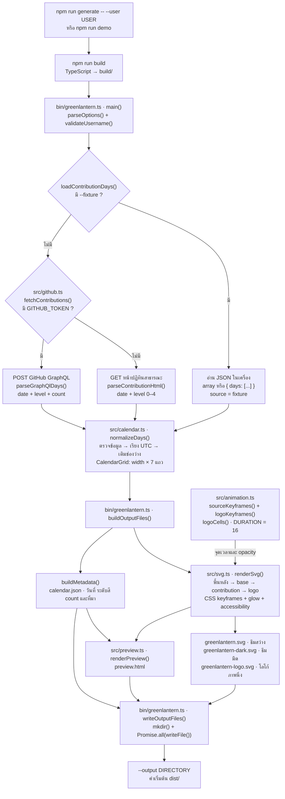
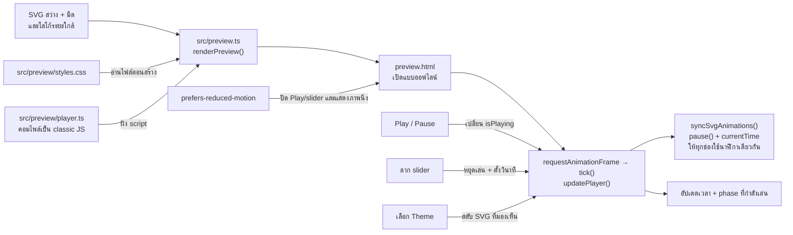
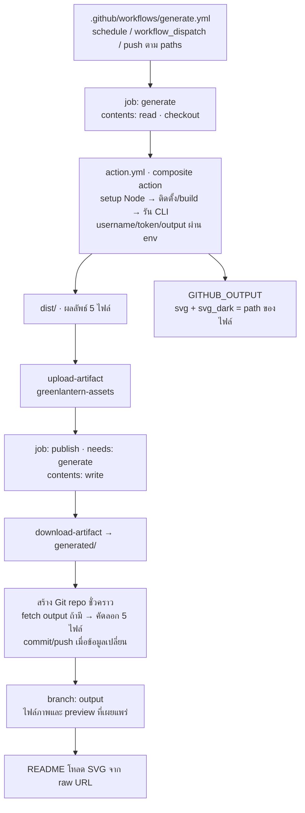
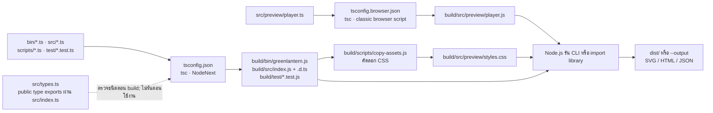

# เส้นทางการทำงานของโปรเจกต์

เริ่มอ่านที่ [`bin/greenlantern.ts`](../bin/greenlantern.ts): CLI รับ username → โหลด contribution → จัดกริดตามวันที่ → สร้าง SVG และหน้า preview → เขียนไฟล์ แผนภาพด้านล่างอ้างถึง **ไฟล์ TypeScript ที่แก้ไข** ส่วน Node.js รัน JavaScript ที่คอมไพล์ใน `build/`

[เปิดแผนภาพที่เลือกดูหน้าที่ของแต่ละไฟล์ได้](diagrams/project-flow.html)

## 1. จากคำสั่ง CLI ไปเป็นไฟล์ภาพ

| จุดที่เข้า | ฟังก์ชันหลัก / หน้าที่ |
| --- | --- |
| [`bin/greenlantern.ts`](../bin/greenlantern.ts) | `main()` ประสานทั้ง pipeline; `parseOptions()` รับ `--user`, `--fixture`, `--output`, `--help`; `loadContributionDays()` เลือกข้อมูล; `buildOutputFiles()` สร้างเนื้อหา; `writeOutputFiles()` เขียน 5 ไฟล์ |
| [`src/index.ts`](../src/index.ts) | จุด export ของ library: รวมฟังก์ชันสาธารณะและ public types ไม่ได้เรียก `main()` และไม่เขียนไฟล์เมื่อ import |
| [`src/github.ts`](../src/github.ts) | `validateUsername()` ตรวจชื่อ; `fetchContributions()` เลือก public HTML หรือ GraphQL; `createRequest()` สร้าง request; `parseContributionHtml()` / `parseGraphQlDays()` แปลง response เป็น contribution days |
| [`src/calendar.ts`](../src/calendar.ts) | `normalizeDays()` ใช้ `validateAndSortDays()` และ `parseDateTimestamp()` ตรวจวันที่จริง วันที่ซ้ำ level และ count; หาคอลัมน์จากวันอาทิตย์แรกด้วย UTC; คืนกริดแบบเรียงทีละคอลัมน์ |
| [`src/animation.ts`](../src/animation.ts) | `logoCells()` วางโลโก้ 5 × 7 จำนวน 22 ช่องตรงกลาง; `sourceKeyframes()` / `logoKeyframes()` คืนคู่เวลา–opacity; `sampleFrame()` ใช้ `sourceOpacity()` / `logoOpacity()` คำนวณค่าของแต่ละช่อง ณ เวลาหนึ่ง |
| [`src/svg.ts`](../src/svg.ts) | `renderSvg()` เลือก palette และ mode; `renderBaseCells()`, `renderContributions()`, `renderLogo()` สร้างแต่ละชั้น; `renderKeyframes()` เปลี่ยนวินาทีเป็นเปอร์เซ็นต์ CSS; `createIdPrefix()` แยก IDs ของ SVG แต่ละภาพ |
| [`src/preview.ts`](../src/preview.ts) | `renderPreview()` ประกอบ SVG ธีมสว่าง/มืด ภาพโลโก้ระยะใกล้ ข้อมูลที่ escape แล้ว CSS และ player เป็น HTML ไฟล์เดียว |
| [`src/preview/player.ts`](../src/preview/player.ts) | JavaScript ฝั่ง browser: `tick()` เดินนาฬิกา; `updatePlayer()` อัปเดต slider/เวลา/phase; `syncSvgAnimations()` ตั้ง `Animation.currentTime` ให้ SVG ทุกชิ้นตรงกัน |
| [`src/preview/styles.css`](../src/preview/styles.css) | หน้าตาและ layout ของ preview; build คัดลอกไฟล์นี้ไปข้าง player ที่คอมไพล์แล้ว |
| [`src/types.ts`](../src/types.ts) | สัญญาของข้อมูล เช่น `ContributionDay`, `CalendarGrid`, `Keyframe`, `CalendarMetadata`, options และผลลัพธ์ของ API; type ถูกลบออกเมื่อคอมไพล์ |
| [`src/validation.ts`](../src/validation.ts) | `isRecord()` และ `isContributionLevel()` เป็น type guards ที่รันจริง ตรวจค่าที่มาจาก JSON/HTML ก่อนให้โมดูลอื่นใช้งาน |
| [`scripts/copy-assets.ts`](../scripts/copy-assets.ts) | ขั้น build สำหรับนำ CSS ไป `build/src/preview/styles.css` เพื่อให้ `renderPreview()` อ่านและฝังลงผลลัพธ์ได้ |

`--fixture` ไม่เรียกเครือข่าย ส่วนโหมด GitHub ตรวจข้อมูลวันที่/level/count ก่อนส่งกลับ และ CLI เรียก `normalizeDays()` อีกครั้งเพื่อใช้กริดจริง หาก token ใช้ไม่ได้จะคืนข้อผิดพลาด โดยไม่เปลี่ยนไปใช้ public HTML อัตโนมัติ เวลา request เริ่มต้นคือ 20 วินาที และข้อความผิดพลาดไม่สะท้อน token หรือ response body

ช่องที่ไม่มีข้อมูลต้นทางจะมี `date: null` และ `level: 0`; แถว 0 คืออาทิตย์ แถว 6 คือเสาร์ ความกว้างตามช่วงวันที่ ไม่กำหนดตายตัวเป็น 52 สัปดาห์ `normalizeDays()` จัดกริดสั้นได้ แต่ `renderSvg()` ต้องการอย่างน้อย 5 คอลัมน์สำหรับโลโก้

## 2. Timeline เป็นสูตร ส่วน SVG เป็นผู้เล่น

| เวลาในลูป | ผลจาก `src/animation.ts` |
| --- | --- |
| 0–2 วินาที | คง contribution เดิม |
| 2–8 วินาที | ลด opacity จากคอลัมน์ด้านนอกเข้าหากลาง โดยเหลื่อมเวลาแต่ละแถว |
| 6–10 วินาที | เปิดไฟโลโก้ 22 ช่องตามลำดับแถว; ช่วงนี้ซ้อนกับการดับ contribution |
| 10–13 วินาที | แสดงโลโก้ครบและเต้นแสงเบา ๆ |
| 13–16 วินาที | เพิ่ม contribution กลับและลดโลโก้ ก่อนวนรอบ |

`renderSvg()` ขอ keyframes แล้วเขียน CSS ลง SVG ให้ browser interpolate เอง ไม่ได้เรียก `sampleFrame()` ทีละเฟรม ฟังก์ชัน `sampleFrame(grid, seconds)` เป็น API สำหรับตรวจเฟรมหรือใช้ต่อกับ renderer อื่น แต่ยังไม่ได้สร้าง GIF/MP4 ใน pipeline นี้

SVG วาดตามลำดับ **พื้นหลัง → base cells ทุกช่อง → contribution ที่ level > 0 → logo**; โหมด `logo` ข้าม contribution และโหมด `calendar` ข้าม logo ส่วน `prefers-reduced-motion` ในโหมด animated จะคง contribution และซ่อน logo ภาพ SVG ไม่มี player script และโหลดใช้เป็นภาพใน README ได้โดยตรง

## 3. Browser preview ทำงานต่ออย่างไร

เมื่อเปิด `preview.html` จะมี SVG สองธีมอยู่แล้ว การเปลี่ยนธีมสลับการแสดงผลโดยคงเวลาเดิม ส่วน player หยุด CSS animations แต่ละตัวแล้วกำหนด `currentTime` จากนาฬิกากลาง จึงลากตรวจเฟรมได้ตรงกันทั้งปฏิทิน หน้า preview ไม่อ่าน GitHub ใหม่

## 4. GitHub Actions สร้างและเผยแพร่

Workflow ตั้งเวลา `17 0 * * *` หรือ 07:17 น. ประเทศไทยทุกวัน และรับ username ตอนสั่งด้วยมือ; ค่าว่างใช้เจ้าของ repository `action.yml` สร้างไฟล์และคืน path ของ SVG เท่านั้น ส่วน job `publish` นำ artifact ไปอัปเดต branch `output` ใช้ GitHub CLI credential helper และ push ตามประวัติเดิมเมื่อไฟล์เปลี่ยน

[`ci.yml`](../.github/workflows/ci.yml) แยกจากการเผยแพร่: ตรวจบน Ubuntu/Windows และ Node 22/24 ด้วย `npm ci`, `npm test`, `npm run typecheck`, `npm run demo`, `npm pack --dry-run` การทดสอบใช้ built-in `node:test` และรันไฟล์ที่คอมไพล์แล้วใน `build/test/`

## 5. แยก source, build และข้อมูลผลลัพธ์

| สิ่งที่ต้องทำ | ไฟล์ที่อ่าน/รัน |
| --- | --- |
| แก้พฤติกรรมโปรเจกต์ | แก้ `.ts` ใน `bin/`, `src/`, `scripts/`, `test/` |
| ใช้ CLI หลัง build | `node build/bin/greenlantern.js --user USER --output dist` |
| ใช้ library หลัง build | import ผ่าน package export หรือ `build/src/index.js` |
| เข้าใจชนิดข้อมูล | อ่าน `src/types.ts`; declaration `.d.ts` ใน `build/` ช่วยผู้ใช้ TypeScript |
| ดูไฟล์ที่สร้าง | เปิด `dist/preview.html` หรือไดเรกทอรีที่ส่งให้ `--output` |

Source ใช้ import ที่ลงท้าย `.js` ตาม NodeNext แม้ไฟล์ที่แก้เป็น `.ts`; TypeScript จับคู่ source แล้วคง specifier ให้ Node.js ใช้ไฟล์ใน `build/` ได้ Public runtime exports คือ `normalizeDays`, `fetchContributions`, `parseContributionHtml`, `validateUsername`, `DURATION`, `LOGO`, `logoCells`, `sampleFrame`, `sourceOpacity`, `logoOpacity`, `renderSvg` ส่วน `sourceKeyframes`, `logoKeyframes`, `escapeXml`, `renderPreview` เป็น exports ของโมดูลเฉพาะที่ใช้ภายใน ไม่ได้อยู่ใน package entry point

Type exports ช่วยตรวจข้อมูลขณะพัฒนาและหายไปจาก JavaScript จึงยังต้องมีการตรวจ input ตอน runtime: CLI, `github.ts`, `calendar.ts` ใช้ helpers ใน `validation.ts` และ `svg.ts` ตรวจ options/ขนาดกริดด้วย `validateRenderOptions()` เอง `build/` คือโค้ดที่คอมไพล์แล้ว ส่วน `dist/` คือภาพ/HTML/JSON ที่ CLI สร้าง เป็นคนละหน้าที่กัน
